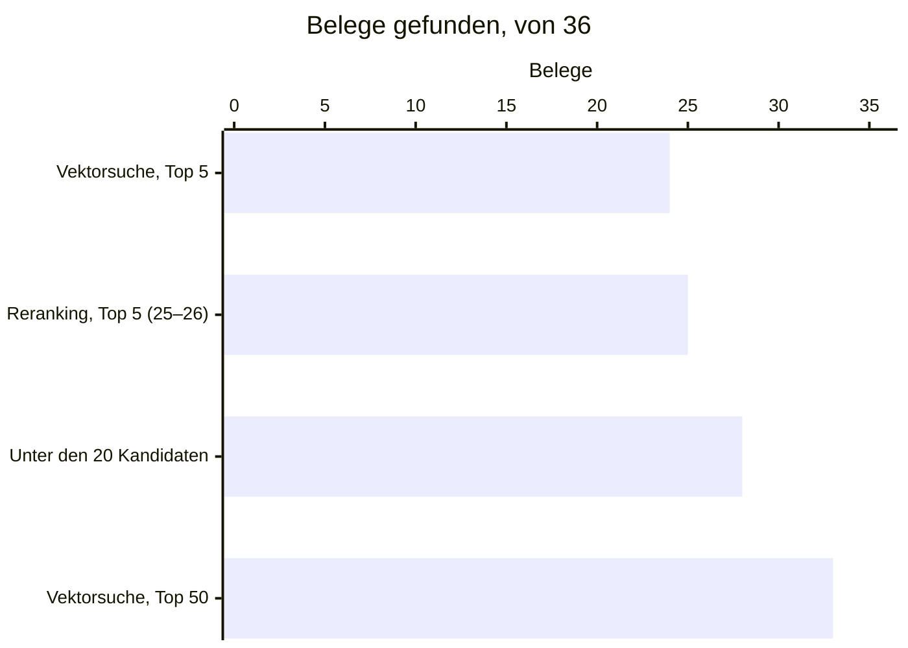
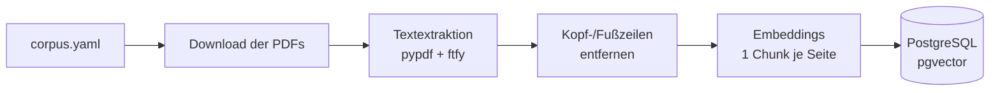
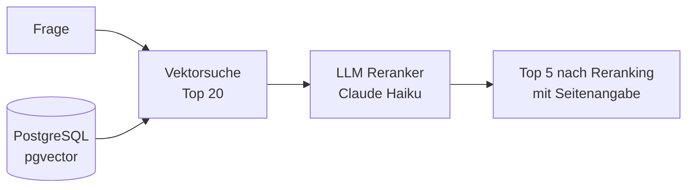
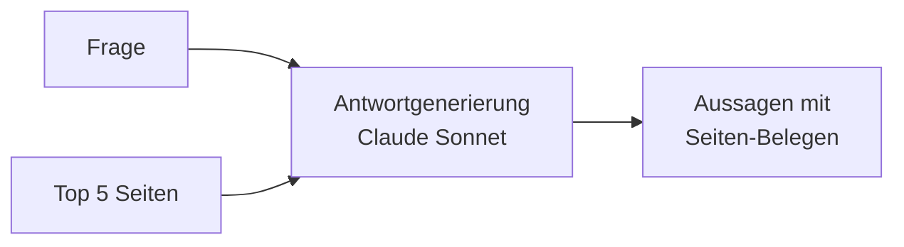

# Anlagen-Copilot

[](https://github.com/fknoerzer/anlagen-copilot/actions/workflows/ci.yml)
[](https://www.repostatus.org/#active)

> **In Arbeit:** die Prüfung, ob die zitierte Seite jede Aussage trägt (siehe [Stand und Grenzen](#stand-und-grenzen)).

Ein RAG-System für technische Dokumentation aus der Antriebstechnik: Es beantwortet Fragen zu Getrieben, Motoren, Frequenzumrichtern und Schmierstoffen aus echten Herstellerhandbüchern, mit Quellenangabe bis auf die Seite. Zu jeder Frage holt eine Vektorsuche 20 Handbuchseiten, ein Sprachmodell wählt daraus die 5 relevantesten (Reranking), ein zweites antwortet nur aus diesen 5.

Das Projekt zeigt Retrieval über einen schwierigen deutschsprachigen Korpus, LLM-basiertes Reranking, Antworten, die jede Aussage auf eine Handbuchseite zurückführen oder ablehnen, und zwei Evaluationen, an denen sich jede Änderung messen lässt: Die erste prüft, ob die richtige Seite gefunden wird; die zweite, ob die Antwort sie zitiert, unbeantwortbare Fragen ablehnt und die erwarteten Fakten nennt.

## Das Problem

Industriehandbücher sind ein schwerer Fall für Retrieval:

- **Die Seiten eines Handbuchs gleichen sich.** Hunderte Seiten mit demselben Vokabular, denselben Bauteilnamen, demselben Layout. Eine Vektorsuche findet zuverlässig das richtige *Thema*, aber nicht die Seite, auf der die *Antwort* steht.
- **Antworten stecken in Tabellen und Zeichnungen.** Schmierstoffmengen, Parameterlisten, Explosionszeichnungen mit Positionsnummern: Inhalte, die eine PDF-Textextraktion nur teilweise übersteht.
- **Manche Fragen brauchen zwei Dokumente.** Welches Öl in ein Getriebe gehört, steht in der Betriebsanleitung; welche Produkte dafür freigegeben sind, in der Schmierstofftabelle.

Der Korpus umfasst **6 Handbücher** von SEW-EURODRIVE und Siemens (SINAMICS G120C) mit zusammen 1.810 Seiten, von denen 1.322 im Index landen ([welche und warum](docs/setup.md#4-korpus-laden-und-indexieren)).

## Ergebnisse

Das Eval-Set hat 37 Fragen: 32 beantwortbare mit zusammen 36 Belegseiten (Multi-Hop-Fragen brauchen zwei) und 5 unbeantwortbare. Ein **Beleg** ist die Handbuchseite, auf der die Antwort steht; gezählt wird beim Retrieval je Beleg, nicht je Frage.

Gemessen auf Eval-Set v4, Commit `e85aab9`, Strategie `naive`; Spannen über drei Läufe (Retrieval, Fakten) bzw. fünf (Antworten), weil Reranker und Modelle nicht deterministisch sind. Läufe, Commits, Zählweise und die Zahlen je Fragetyp stehen in [docs/messungen.md](docs/messungen.md).

### Retrieval

**Die Messfrage:** Landet die Seite, auf der die Antwort steht, unter den 5 Seiten, die an das Sprachmodell gehen? Was dort fehlt, kann keine Antwort zitieren.



Beim Reranking holt die Vektorsuche 20 Kandidaten, ein Sprachmodell (Claude Haiku 4.5) wählt daraus die besten 5. Von den 28 Belegen unter den Kandidaten bringt es 25–26 in die Top 5; **8 kommen gar nicht erst unter die Kandidaten**. Der größere Hebel liegt also vor dem Reranking, nicht darin. Profitieren können davon nur Fragen, die zwei Handbücher brauchen:

| Fragetyp | Nur Vektorsuche | Unter den 20 Kandidaten | Mit Reranking |
|---|---:|---:|---:|
| Zwei Handbücher (Multi-Hop) | 3 / 8 | 6 / 8 | 4–5 / 8 |
| Zeichnung | 5 / 7 | 6 / 7 | 5 / 7 |
| Nachschlagen | 10 / 13 | 10 / 13 | 10 / 13 |
| Tabelle | 6 / 8 | 6 / 8 | 6 / 8 |
| **Gesamt** | **24 / 36 (67 %)** | **28 / 36 (78 %)** | **25–26 / 36 (69–72 %)** |

### Generierung

Claude Sonnet 5 antwortet aus den 5 Seiten nach dem Reranking.

- **Belege:** Liegt ein Beleg im Prompt, zitiert die Antwort ihn in 88–96 % der Fälle.
- **Ablehnung:** Die 5 Fragen, die die Handbücher nicht beantworten, lehnt das Modell in allen Läufen ab; von 32 beantwortbaren lehnt es 4–5 fälschlich ab, bei dreien davon lag der Beleg nicht im Prompt.
- **Fakten:** Ein drittes Modell (Claude Sonnet 5.5) prüft jede Antwort gegen die erforderlichen Fakten ihrer Frage. 64–74 % der Antworten auf beantwortbare Fragen nennen alle; wiederholt widersprochen wird etwa, wenn eine Antwort die zulässige Ölsumpftemperatur als Umgebungstemperatur ausgibt.

### Docling gegen pypdf

Die Strategie `advanced` liest die Handbücher mit Docling statt pypdf ([ADR 015](docs/adr/015-docling-fuer-advanced.md)), je drei Läufe auf `c4e7435`:

| | `naive` (pypdf) | `advanced` (Docling) |
|---|---:|---:|
| Vektorsuche, Top 5 | 24 / 36 | 22 / 36 |
| Reranking, Top 5 | 25–26 / 36 | 27 / 36 |
| Antworten mit allen Fakten | 64–74 % | 61–62 % |

Docling hilft dem Reranking, vor allem bei Multi-Hop, aber noch nicht den Antworten; Reranking und Generierung lesen dafür 10–16 % mehr Tokens.

### Kosten und Latenz

| | Nur Vektorsuche | Mit Reranking | Antwortgenerierung (zusätzlich) | Gesamt |
|---|---:|---:|---:|---:|
| Kosten je Eval-Lauf (37 Fragen) | < 0,01 $ | ~0,59 $ | 0,61–0,66 $ | ~1,20–1,25 $ |
| Latenz je Frage (Median) | 0,2 s | 2,3–2,5 s | 4,2–5,4 s | ~6,5–7,9 s |

Die Gesamtspalte ist die Summe der beiden Spalten davor, kein eigener Messwert; bei der Latenz ist es die Summe zweier Mediane.

## Stand und Grenzen

- [x] Ingestion (naive Strategie: eine Seite = ein Chunk)
- [x] Vektorsuche
- [x] LLM-Reranking
- [x] Retrieval-Evaluation mit protokollierten Läufen
- [x] Antwortgenerierung mit Seitenzitaten
- [x] Evaluation der Antworten: Ablehnung, Belege und erwartete Fakten
- [ ] Prüfung, ob die zitierte Seite jede Aussage trägt
- [x] Layoutbewusste Ingestion mit Docling (Strategie `advanced`)
- [x] API (`POST /api/ask`) und eine Oberfläche, die beide Indizes nebeneinander antworten lässt

### Bekannte Grenzen

Das Eval-Set ist klein: Eine Belegseite bewegt den Gesamtwert um knapp 3 Prozentpunkte, bei Multi-Hop um gut 12, und bei den fünf unbeantwortbaren Fragen zählt jede Frage 20 Prozentpunkte. Gemessen wird auf einem einzigen Korpus aus sechs Handbüchern zweier Hersteller. pypdf verliert die Spalten von Tabellen. Die Fakten bewertet ein Sprachmodell; die 55 Urteile des ersten Laufs sind von Hand nachgeprüft. Aussagen über die erforderlichen Fakten hinaus prüft es nicht: Ist eine davon falsch, gilt die Antwort trotzdem als vollständig.

## Architektur

### Ingestion



Die Handbücher werden anhand des Manifests `data/raw/corpus.yaml` von den Herstellerseiten geladen.

- **Extraktion:** pypdf liest Seite für Seite; ftfy repariert Zeichen, die bei unbekanntem Font-Encoding als unsichtbare Steuerzeichen ankommen. Die Strategie `advanced` liest stattdessen mit Docling, das Tabellen in ihren Spalten und den Text aus Zeichnungen erhält.
- **Bereinigung:** Zeilen, die auf mindestens 85 % der Seiten eines Dokuments wiederkehren (Kopf- und Fußzeilen), werden entfernt, damit sie nicht jede Seite gleich aussehen lassen.
- **Chunking:** Eine Seite = ein Chunk, mit der Seitennummer des Original-PDFs, damit jede Quelle seitengenau zitierbar ist. Seiten ohne Text (Scans, Grafiken) fallen weg. ([ADR 001](docs/adr/001-seite-als-chunk.md))
- **Embedding:** `text-embedding-3-large` mit 1536 Dimensionen; Fragen laufen durch dieselbe Funktion und landen so im selben Vektorraum. ([ADR 003](docs/adr/003-embedding-dimensionen.md))
- **Speichern:** Eine Transaktion je Dokument; ein erneuter Lauf ersetzt den alten Stand. ([ADR 006](docs/adr/006-transaktion-pro-dokument.md))

### Abfrage



- **Retrieval:** Die Vektorsuche holt 20 Kandidaten.
- **Reranking:** Ein LLM liest Frage und Kandidaten gemeinsam und vergibt je Seite eine Relevanzstufe von 0 bis 3. Sortiert wird nach Stufe, innerhalb einer Stufe nach Vektor-Score.

### Generierung



- **Antwort:** Ein LLM antwortet nur aus den 5 Seiten, als Liste von Aussagen, von denen jede die Seiten nennt, aus denen sie stammt. ([ADR 013](docs/adr/013-antworten-als-aussagen.md))
- **Ablehnung:** Tragen die Seiten die Frage nicht, lehnt es ab, statt aus eigenem Wissen zu antworten.
- **Prüfung:** Ungültige Seitenangaben, eine Ablehnung mit Belegen oder eine Antwort ganz ohne Beleg lassen den Aufruf scheitern.

### Tech Stack

- **Sprache:** Python 3.12+
- **Package Manager:** [uv](https://docs.astral.sh/uv/)
- **Vektordatenbank:** PostgreSQL 16 mit [pgvector](https://github.com/pgvector/pgvector)
- **Modelle:** OpenAI für Embeddings, Anthropic Claude für Reranking, Generierung und Faktenprüfung
- **PDF-Extraktion:** pypdf + ftfy, für die Strategie `advanced` [Docling](https://github.com/docling-project/docling)
- **Validierung & Konfiguration:** Pydantic, pydantic-settings
- **API & Oberfläche:** FastAPI mit Uvicorn, Streamlit

## Designentscheidungen

Die wichtigsten Entscheidungen in einem Satz. Kontext, verworfene Alternativen und Konsequenzen stehen im jeweils verlinkten Architecture Decision Record; alle siebzehn ADRs listet [docs/adr/README.md](docs/adr/README.md).

- **Eine Seite = ein Chunk**, damit jede Quelle auf die PDF-Seite genau zitierbar ist. ([ADR 001](docs/adr/001-seite-als-chunk.md))
- **Reranker-Noten mit Seiten-ID, über strukturierte Ausgabe**, weil ein Format ohne IDs Tokens spart, aber Belegseiten verliert. ([ADR 004](docs/adr/004-reranker-ausgabe.md), [ADR 012](docs/adr/012-strukturierte-ausgabe.md))
- **Kein stiller Rückfall auf die Reihenfolge der Vektorsuche**, damit kein Eval-Lauf ein Reranking protokolliert, das nicht stattgefunden hat. ([ADR 005](docs/adr/005-kein-stiller-rueckfall.md))
- **Vollständige Suche statt HNSW-Index**, weil der Index Seiten auslassen kann und bei 1.322 Seiten keine Zeit spart, sobald er zuverlässig sucht. ([ADR 011](docs/adr/011-vollstaendige-suche-statt-hnsw.md))
- **Kein RAG-Framework**, damit sich jeder Schritt der Pipeline einzeln steuern, testen und messen lässt. ([ADR 010](docs/adr/010-kein-rag-framework.md))
- **Antworten als Aussagen mit Seiten-IDs**, statt Zitatmarken wie `[2]` im Fließtext, damit jede Aussage ihren Beleg trägt und kein Suchmuster Zitate aus dem Text lesen muss, wo Einheiten wie `[1/min]` ebenfalls in eckigen Klammern stehen. ([ADR 013](docs/adr/013-antworten-als-aussagen.md))
- **Docling für die Strategie `advanced`, weiter eine Seite je Chunk**, damit sich die Wirkung der Extraktion allein messen lässt; die defekte Textebene des Projektierungskatalogs wird gezielt repariert, nachdem volle OCR gemessen gescheitert ist. ([ADR 015](docs/adr/015-docling-fuer-advanced.md))
- **Ein eigenes Judge-Modell prüft die erforderlichen Fakten**, getrennt von ergänzenden, damit eine kurze richtige Antwort nicht durchfällt und der Generator sich nicht selbst bewertet. ([ADR 016](docs/adr/016-faktenpruefung-mit-judge.md))
- **Die API läuft durch dieselbe Pipeline wie die Eval**, mit der gemessenen Konfiguration, damit die Zahlen für das gelten, was ausgeliefert wird. ([ADR 017](docs/adr/017-api-antwortet-wie-gemessen.md))

## Entwicklung mit Claude Code

Ziel des Projekts ist, die Mechanik eines RAG-Systems durch Eigenbau zu verstehen. Ingestion, Retrieval, Reranking und Evaluation sind daher im Kern von Hand geschrieben; die zugrunde liegenden Entscheidungen sind in den Docstrings begründet.

[Claude Code](https://claude.com/claude-code) war dabei Mentor und Reviewer, nicht Autor: Bei Fragen zur Kernlogik erklärt es erst das Konzept, ordnet es in die Pipeline und die bestehenden ADRs ein und schlägt einen ersten Test vor, schreibt den Code aber nicht. Reviews, Boilerplate, Testgerüste und Dokumentation hat es übernommen, nicht aber die Bewertung von Messergebnissen: Die Ground Truth des Eval-Sets ist manuell gegen die Quelldokumente verifiziert, Retrieval-Entscheidungen entstanden aus Handproben an Einzelfragen.

Diese Arbeitsteilung ist im Werkzeug verankert: Ein Hook sperrt Schreibzugriffe auf `src/**`, freigeschaltet nur für einen einzelnen Auftrag. Regeln, Hooks und Skills beschreibt [docs/claude-code.md](docs/claude-code.md).

## Codequalität

- **Über 180 automatisierte Tests** (`uv run pytest`), ohne echte API-Calls: Die OpenAI- und Anthropic-Clients werden durch Fakes ersetzt. Integrationstests gegen PostgreSQL laufen, wenn die Datenbank verfügbar ist.
- **Ohne Keys und ohne Docker prüfbar:** `uv sync --dev && uv run pytest` läuft in etwa 25 Sekunden durch. Die Tests setzen eigene Platzhalter-Keys und lesen keine `.env`; ohne Datenbank werden nur die Integrationstests übersprungen. Die Tests, die Docling-Modelle laden, laufen nur mit `-m docling`.
- **Statische Typprüfung** mit mypy, **Linting & Formatierung** mit Ruff, **Abhängigkeitsprüfung** mit deptry.
- **Pre-commit-Hooks** für Ruff, mypy und deptry.
- **CI-Pipeline** (GitHub Actions) mit pgvector-Service-Container: Ruff, mypy, deptry und die komplette Testsuite inklusive Datenbanktests bei jedem Push.

Die einzelnen Befehle stehen in [docs/setup.md](docs/setup.md#entwicklungsbefehle).

## Schnellstart

Für einen echten Lauf: Python 3.12, [uv](https://docs.astral.sh/uv/), Docker sowie API-Keys für OpenAI und Anthropic.

```bash
git clone https://github.com/fknoerzer/anlagen-copilot.git
cd anlagen-copilot
uv sync --dev
cp .env.example .env   # OPENAI_API_KEY und ANTHROPIC_API_KEY eintragen
docker compose up -d
uv run python -m anlagen_copilot.scripts.init_db
uv run anlagen-copilot   # Handbücher laden und indexieren

uv run python -m anlagen_copilot.scripts.eval_retrieval --k 5 --candidates 20 --reranker claude-haiku-4-5-20251001
uv run python -m anlagen_copilot.scripts.eval_generate --k 5 --candidates 20 --reranker claude-haiku-4-5-20251001
uv run python -m anlagen_copilot.scripts.eval_facts   # prüft den neuesten Antwortlauf
```

API und Oberfläche, jeweils in einem eigenen Terminal:

```bash
INGEST_STRATEGY=advanced uv run anlagen-copilot   # Docling-Index, rund 1 h 40 min auf der CPU
uv run anlagen-copilot-api
uv run --extra ui streamlit run ui/streamlit_app.py
```

Die API sucht standardmäßig im Docling-Index; wer nur `naive` indexiert hat, setzt `ASK_STRATEGY=naive` in der `.env`.

Die ausführliche Fassung mit Erklärungen zu jedem Schritt steht in [docs/setup.md](docs/setup.md); alle Optionen der Eval-Skripte zeigt `--help`.

## Lizenz

[MIT](LICENSE)
